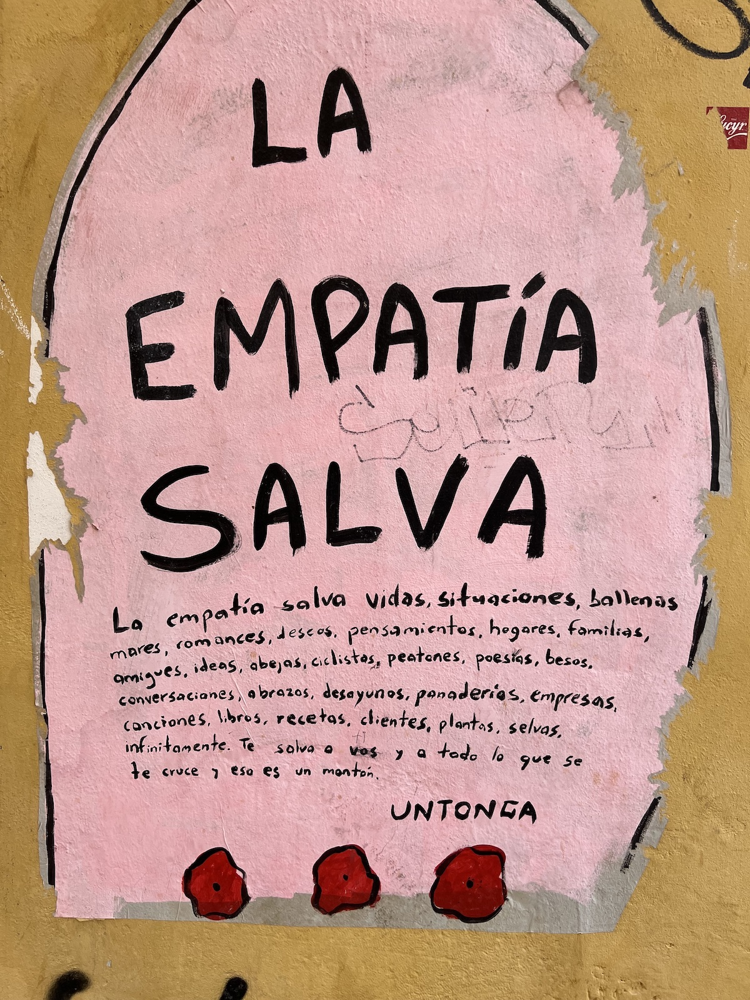

As I was walking around downtown the other day, this graffiti caught my eye.

Roughly translated, it says:

Empathy saves… Empathy saves lives, situations, whales, oceans, relationships, wishes, thoughts, homes, families, friends, ideas, bees, cyclists, pedestrians, poems, kisses, conversations, hugs, breakfasts, bakeries, companies, songs, books, recipes, clients, plants, jungles. It saves you and everything along your way, and that’s a lot.

I couldn't have said it better myself. – We need more empathy everywhere.

* * *

Photo taken near Mercado Central in Valencia
{: .photo-credit}