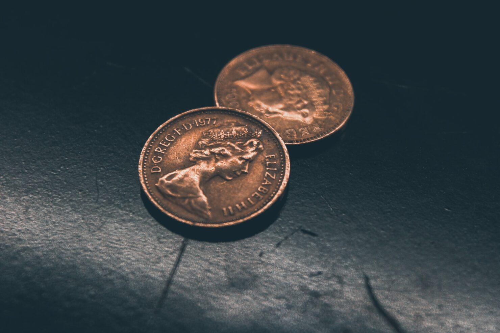

While it might be tempting to go for the cheapest option, when it comes to your work tools, it’s not worth it in the long run. 

Tools are an investment. Putting your money into something that will last, and help you do your work faster, will save you time, money, and frustration in the long run.

Buying cheap things means you’ll likely end up replacing them early, spending more on repairs, and often paying two or three times the original price.

So next time you’re thinking about replacing your laptop, camera or buying new tools for work, keep in mind this adage:

> I’m not rich enough to buy cheap things.

Photo by [Siora Photography](https://unsplash.com/@siora18?utm_source=unsplash&utm_medium=referral&utm_content=creditCopyText) on [Unsplash]](https://unsplash.com/photos/kY6HbkiauSc?utm_source=unsplash&utm_medium=referral&utm_content=creditCopyText)
{: .photo-credit}
