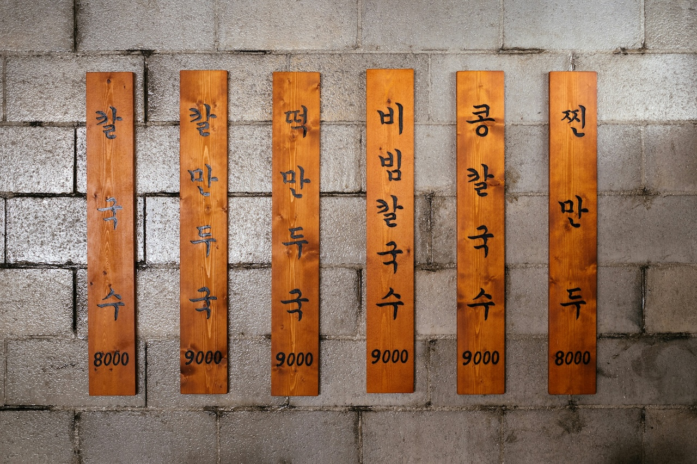

You weren’t hired to be a menu; you were hired to make things happen. Presenting multiple solutions to every problem doesn’t move things forward; it just creates noise and unnecessary debate.

If you’re at a restaurant, options are great. But when you know the best approach, offering bogus choices is just plain stupid. You know what to do, so stop waffling around.

Trust your judgment and do it. Results will speak for themselves. Your value lies in cutting through the noise, not adding to it.

Photo by [rawkkim](https://unsplash.com/@rawkkim?utm_content=creditCopyText&utm_medium=referral&utm_source=unsplash) on [Unsplash](https://unsplash.com/photos/a-number-of-wooden-signs-on-a-wall-1ApuKajC5JE?utm_content=creditCopyText&utm_medium=referral&utm_source=unsplash)
{: .photo-credit}
