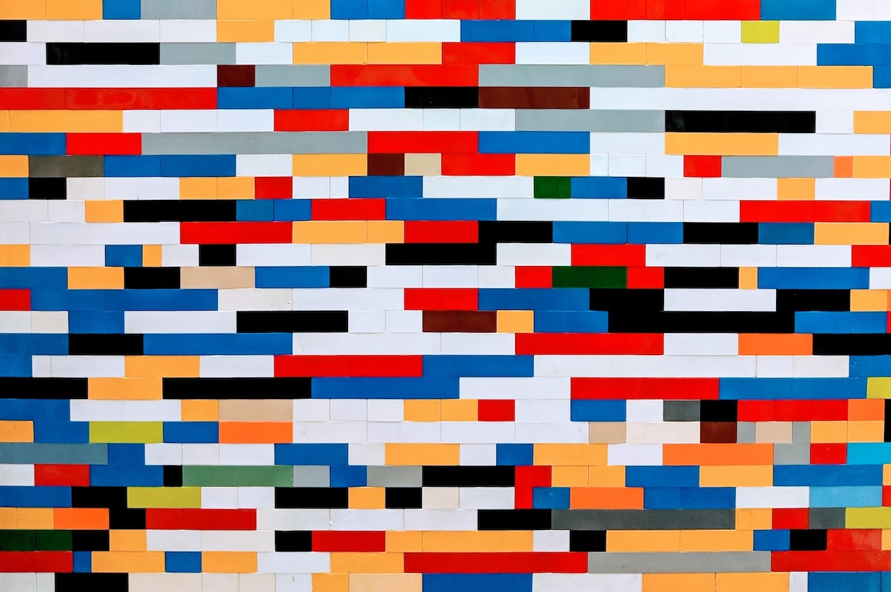

Some people can’t resist the allure of a complete teardown, even when a set of subtle fixes is enough. They dismiss everyone else’s effort as “shit” and push for major overhauls that create chaos for everyone else.

That’s not collaboration; it’s a flex, and It’s more about proving their value than improving the work.

They’ll claim there’s no alternative, that compromise is impossible. But deep down, they know it always is—it’s just less glamorous.

Look for the ones who build, not bulldoze.

Photo by [Omar Flores](https://unsplash.com/@designedbyflores?utm_content=creditCopyText&utm_medium=referral&utm_source=unsplash) on [Unsplash](https://unsplash.com/photos/blue-red-and-white-artwork-lQT_bOWtysE?utm_content=creditCopyText&utm_medium=referral&utm_source=unsplash)
{: .photo-credit}
