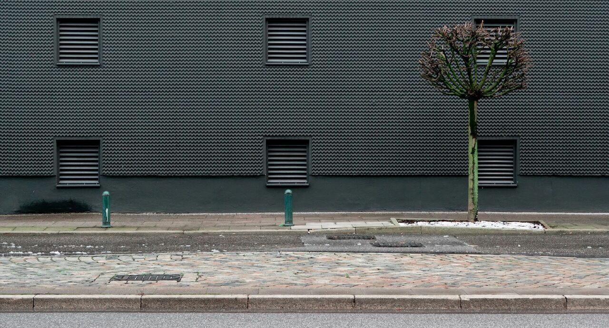

We’ve been told time must be “invested” or “spent wisely.” Even free moments get hijacked by the guilt of productivity – learning something, working on side projects, or “catching up” on errands.

Find time to do nothing. Not the fake nothing where you scroll through your phone while half-watching Netflix. Real nothing. Staring at something, watching people go by. Letting your mind wander. Sitting in silence.

This is not a waste; it’s freeing. Your time doesn’t always need a purpose. Stop trying to fill it. You don’t need an explanation.

Photo by [Lukas S](https://unsplash.com/@hyggesalpaka?utm_content=creditCopyText&utm_medium=referral&utm_source=unsplash) on [Unsplash](https://unsplash.com/photos/a-building-with-a-tree-in-front-of-it-8K2Lkhz2Yyo?utm_content=creditCopyText&utm_medium=referral&utm_source=unsplash)
{: .photo-credit}
