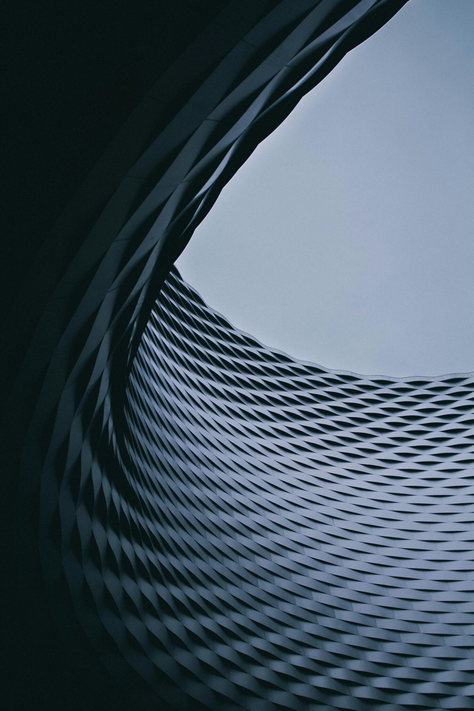

Artists don’t paint by numbers. Yet we keep pushing smart people to stay within the lines and stick to the template.

Connecting dots does not teach you anything, it makes you predictable and dull.

Mastery comes from understanding when rules matter and when they don’t. It can’t be reduced to a checkbox, a list or a sequence of predetermined steps.

Compliance is measured by the number of checkboxes you tick. Quality work is also about the ones you decide to ignore.

Photo by [Victor](https://unsplash.com/@victor_g?utm_content=creditCopyText&utm_medium=referral&utm_source=unsplash) on [Unsplash](https://unsplash.com/photos/black-and-white-stripe-textile-iaquA2snPbk?utm_content=creditCopyText&utm_medium=referral&utm_source=unsplash)
{: .photo-credit}
