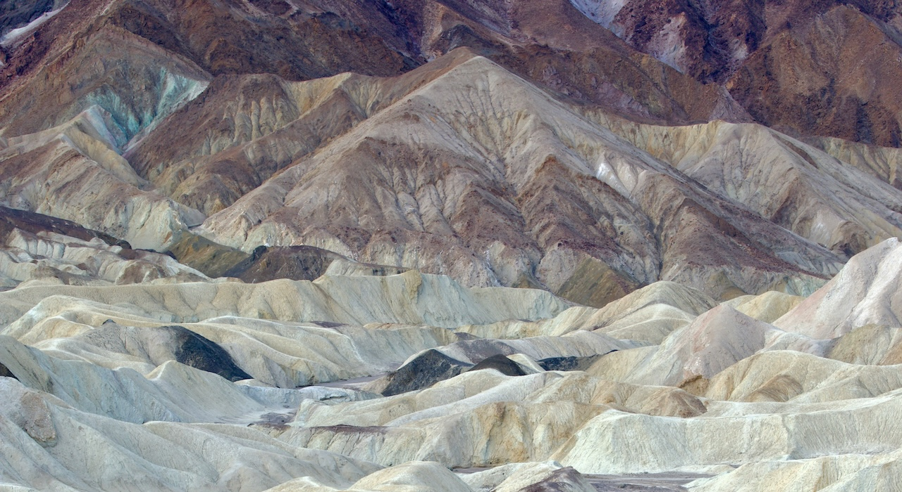

Every day, someone comes up with an idea that could move things forward. A simple change. A small improvement. A step in the right direction that dies under the “bigger picture” mentality.

Simple becomes strategic. Quick becomes quarterly. Immediate morphs into initiative and nothing changes in the end.

We’ve built careers around making easy things hard, rewarding those who plan, validate, and expand a one-line solution into a roadmap, essentially turning actions into dissertations.

Progress comes from protecting simplicity. Most things don’t need consensus. They need someone who gets them done.

Photo by [Steve Gribble](https://unsplash.com/@steve_g_?utm_content=creditCopyText&utm_medium=referral&utm_source=unsplash) on [Unsplash](https://unsplash.com/photos/a-view-of-a-mountain-range-from-a-birds-eye-view-KGnLRfwRs84?utm_content=creditCopyText&utm_medium=referral&utm_source=unsplash)
{: .photo-credit}
