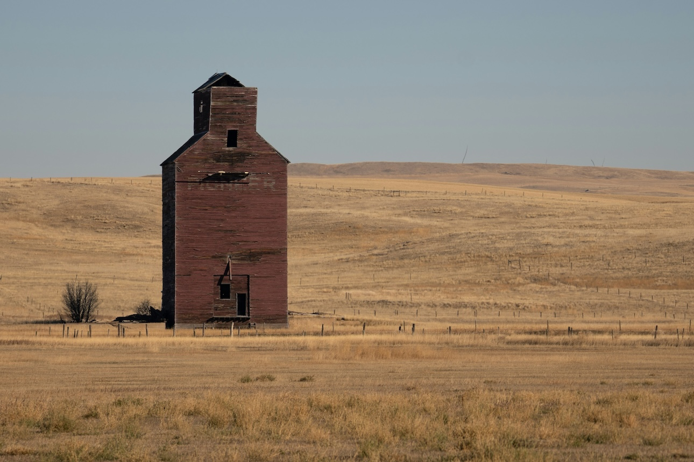

Decisions get easier the further you are from their consequences.

There’s less friction. Less cost. Your work becomes abstract. Something that happens somewhere, to someone.

Abstraction is comfortable. It lets you move fast, simplify, and optimize. Allows you to decide without the weight of living your choices.

But sometimes we forget that the weight doesn’t disappear. It just lands on someone else.

Distance doesn’t make you strategic or pragmatic. It likely just makes you numb.

Photo by [Matt Richmond](https://unsplash.com/@mattrichmo?utm_source=unsplash&utm_medium=referral&utm_content=creditCopyText) on [Unsplash](https://unsplash.com/photos/a-brick-grain-elevator-stands-in-a-dry-field-aYvAyvU4GXA?utm_source=unsplash&utm_medium=referral&utm_content=creditCopyText)
{: .photo-credit}
